<p align="center">
<a href="README.md"></a>
<a href="README.zh-CN.md">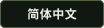</a>
</p>

<h1 align="center">AFTERHOURS</h1>

<p align="center"><strong>Ideas take shape after dark.</strong><br />A nighttime workshop for spatial interfaces and real-time graphics.</p>

<p align="center"><a href="https://playertc5418-art.github.io/afterhours/">Explore the website ↗</a> · <a href="docs/ENGINEERING.md">Engineering notes</a> · <a href="docs/CREDITS.md">Credits</a> · <a href="CONTRIBUTING.md">Contribute</a></p>

[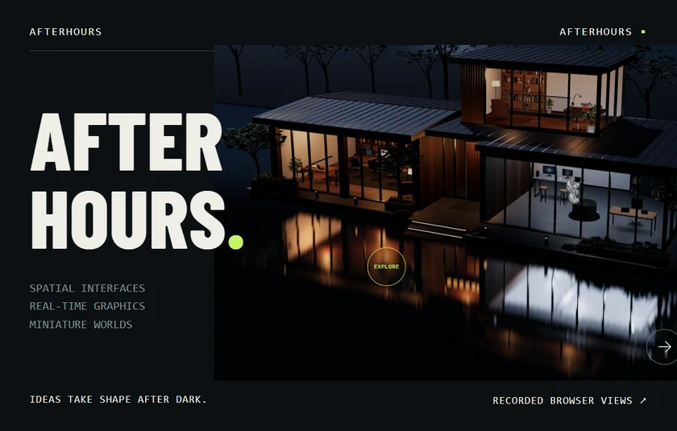](docs/readme/cover-v2.gif)

[▶ View animation](docs/readme/cover-v2.gif) · [Open live demo ↗](https://playertc5418-art.github.io/afterhours/)

A spatial portfolio built around room navigation, interactive shaders, GPU morphing, phased preparation, and standalone mini-worlds with explicit lifecycles.

The previews combine recorded browser frames with explanatory diagrams. Select an image or “View animation” to open its full GIF, or follow “Open live demo” to interact. This README loads static previews by default; sampled animations are not frame-rate benchmarks.

**Jump to:** [Spatial navigation](#spatial-navigation) · [Renderer handoff](#shared-renderer) · [Flow fields](#fluid-typography) · [GPU particles](#particle-morphing) · [Image reveal](#image-reveal) · [Material states](#material-study) · [Singularity](#singularity) · [Gravity Off](#gravity-off) · [Xiaojian](#xiaojian)

<a id="spatial-navigation"></a>

## 01 / Architecture as navigation

[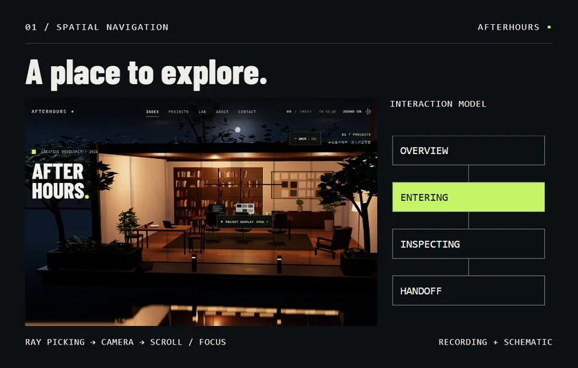](docs/readme/navigation-v2.gif)

[▶ View animation](docs/readme/navigation-v2.gif) · [Open live demo ↗](https://playertc5418-art.github.io/afterhours/)

Rooms and objects act as spatial entry points: click a room to inspect it, then return to the building overview without losing context.

Three.js raycast proxies track scene perspective so hit regions match what you see on screen. A state machine separates `overview`, `entering`, `inspecting`, and `handoff`, keeping camera motion, scroll ownership, and DOM focus in sync. Drag thresholds separate orbiting from clicks, and both the back control and `Escape` exit inspection. Enter a room, look around, trigger an object, and head back; chapter handoff details live in the [engineering notes](docs/ENGINEERING.md).

<a id="shared-renderer"></a>

## 02 / One renderer, two experiences

[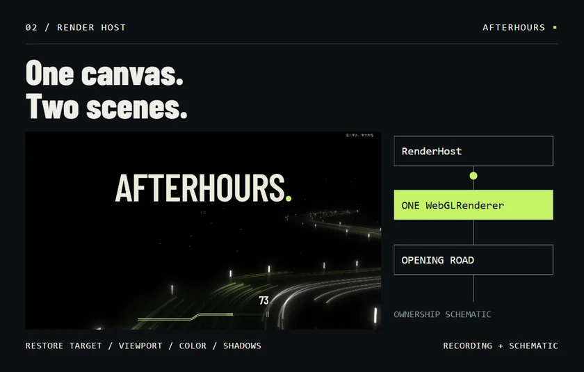](docs/readme/handoff-v2.gif)

[▶ View animation](docs/readme/handoff-v2.gif) · [Open live demo ↗](https://playertc5418-art.github.io/afterhours/)

The opening highway hands control over to the nighttime workshop, sharing one `WebGLRenderer` managed by `RenderHost`. Preparing the home scene before the reveal avoids creating a second host context, while restoring render target, viewport, scissor, color space, tone mapping, exposure, and shadow state keeps settings from one scene from leaking into the next.

This shared renderer applies to the opening and the host site; standalone pieces run their own runtimes. The opening road and light trails are adapted from **[Hyperspeed](https://github.com/DavidHDev/react-bits/blob/e12c22192ac7b4b452c5e2feb9b586d74765d696/src/content/Backgrounds/Hyperspeed/Hyperspeed.jsx) by David Haz / React Bits** (pinned license: MIT + Commons Clause; see [source, terms, and local changes](docs/CREDITS.md)).

<a id="fluid-typography"></a>

## 03 / Fluid typography

[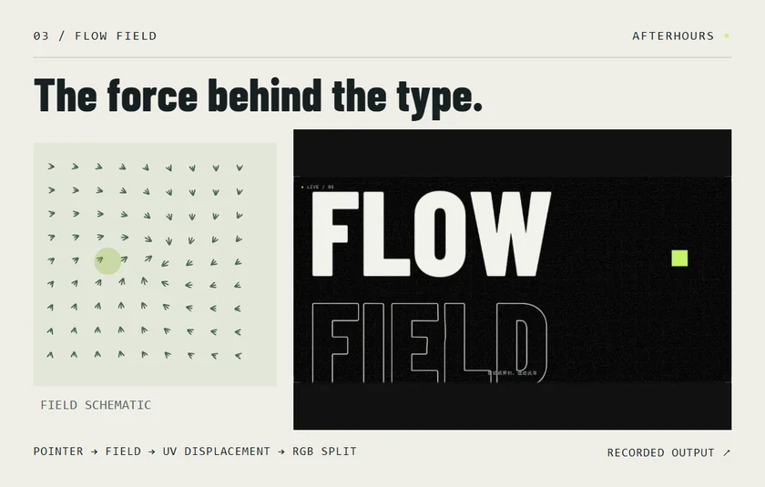](docs/readme/fluid-v2.gif)

[▶ View animation](docs/readme/fluid-v2.gif) · [Open live demo ↗](https://playertc5418-art.github.io/afterhours/#lab)

Left: a conceptual field diagram. Right: recorded display output.

Move the pointer across the letters to bend type, split RGB channels, and watch the injected force decay back to rest.

Two half-float render targets ping-pong between read and write: semi-Lagrangian backtracing advects the previous velocity field while a Gaussian pointer splat adds local force, and the display pass samples the field to offset UVs and separate color channels. A `256 × 144` desktop simulation grid decouples field updates from display resolution, though the full-screen display pass still scales with viewport size. It is a simplified interactive flow field without a full divergence/pressure/projection solver, and falls back to an analytical pointer ripple when required float render targets are unavailable.

<a id="particle-morphing"></a>

## 04 / GPU particle morphing

[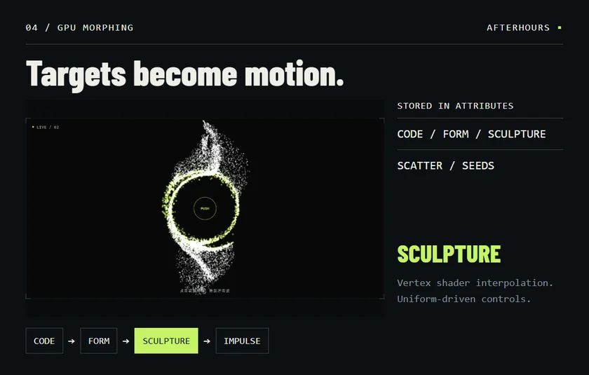](docs/readme/particles-v2.gif)

[▶ View animation](docs/readme/particles-v2.gif) · [Open live demo ↗](https://playertc5418-art.github.io/afterhours/#lab)

Morph a point cloud between `CODE`, `FORM`, and a sculpture, push particles aside with the pointer, and send an expanding shockwave through the form on click.

Canvas2D text sampling and sculpture geometry supply target positions stored in buffer attributes alongside scatter directions and per-particle seeds. The vertex shader handles staggered interpolation, pointer repulsion, and radial impulses while the CPU updates uniforms each frame rather than re-uploading every particle position. The configured counts are `10,000` on desktop and `4,200` on the mobile branch, with target sampling and buffer setup done during preparation. Switch targets, adjust `DISPERSE`, and trigger `IMPULSE` by clicking or pressing Space or Enter in the experiment panel.

<a id="image-reveal"></a>

## 05 / From signal to image

[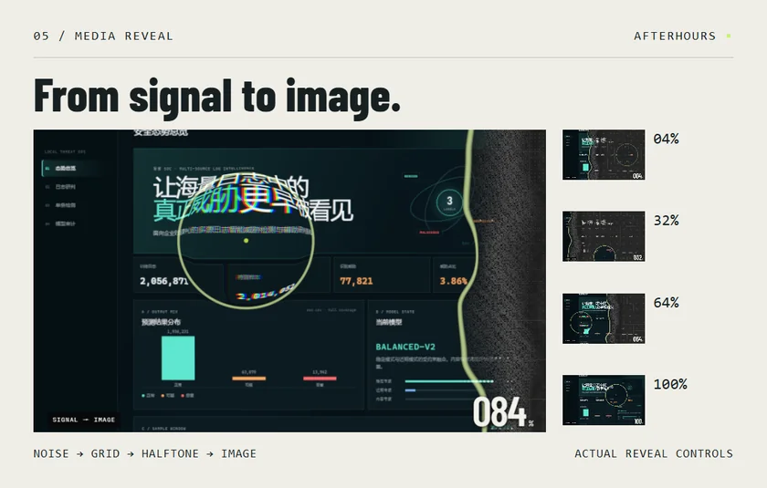](docs/readme/reveal-v2.gif)

[▶ View animation](docs/readme/reveal-v2.gif) · [Open live demo ↗](https://playertc5418-art.github.io/afterhours/#lab)

Bring an image up through noise, grid, and halftone stages, and inspect it through a local pointer lens.

Luminance sets dot radius inside a grid, a scan front blends signal stages toward the source photo, and pointer distance drives UV refraction and chromatic separation. One image drives both halftone sizing and the final reveal, using aspect-aware cover sampling as the panel resizes. The lens is a screen-space shader effect rather than a ray-traced glass object; drag `REVEAL` to scrub the transition directly.

<a id="material-study"></a>

## 06 / One form, five material states

[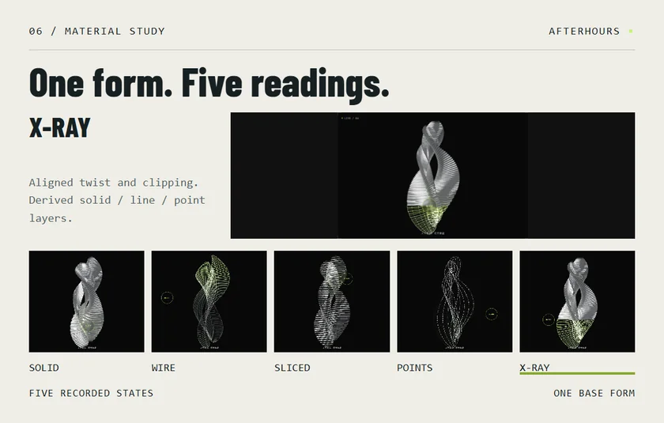](docs/readme/materials-v2.gif)

[▶ View animation](docs/readme/materials-v2.gif) · [Open live demo ↗](https://playertc5418-art.github.io/afterhours/#lab)

Switch between solid, wire, sliced, point, and X-ray views while keeping the underlying form legible across surface, structural, and interior reads.

Solid, line, and point representations derive from a shared base form and receive aligned twist, time, clipping, opacity, and pointer inputs so layers stay in sync; hidden layers stop drawing. Derived line and point geometry still uses extra memory—layers do not all share a single geometry object. The GIF records switching between the five states. Adjust `TWIST` in the live experiment to explore deformation.

<a id="singularity"></a>

## 07 / SINGULARITY — bending light and shaping sound

[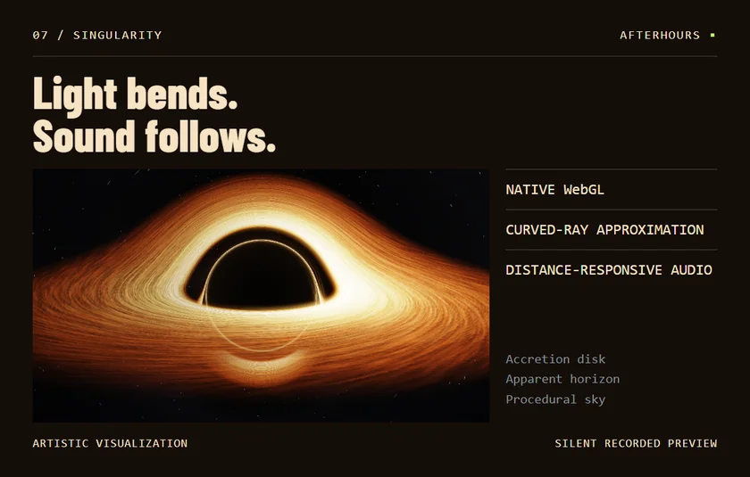](docs/readme/singularity-v2.gif)

[▶ View animation](docs/readme/singularity-v2.gif) · [Open live demo ↗](https://playertc5418-art.github.io/afterhours/sites/blackhole/)

Orbit a glowing accretion disk, switch palettes, or move toward the apparent horizon as visuals and audio respond to camera distance.

Built with native WebGL and custom GLSL, the fragment shader steps an approximately curved ray, accumulates accretion-disk light, and samples a procedural sky, followed by a second pass that reconstructs highlights for bloom and tone mapping. Web Audio smoothly updates gain and low-pass cutoff with distance, mixing an attributed NASA/Chandra sonification recording with synthesized ambience (GIF previews are silent). This is an artistic approximation inspired by black-hole imagery rather than a validated general-relativity simulation, and frame-time / resolution budgets can scale down quality under load.

<a id="gravity-off"></a>

## 08 / GRAVITY OFF — typography with a body

[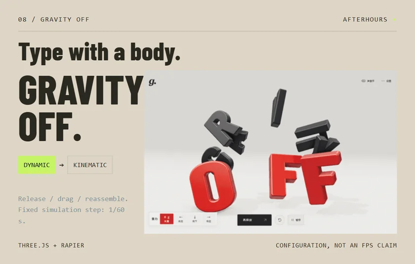](docs/readme/gravity-v2.gif)

[▶ View animation](docs/readme/gravity-v2.gif) · [Open live demo ↗](https://playertc5418-art.github.io/afterhours/sites/gravity-off/)

Drop letters into space, drag them around, change gravity, and reassemble the layout.

Extruded glyphs render in Three.js while Rapier simulates compound convex-hull colliders on a `1/60`-second fixed step accumulated separately from display frames with a catch-up step cap. Dynamic bodies drive free motion and collisions, whereas kinematic bodies guide reassembly back to stored home poses. Physics runs in this standalone experience; the miniature on the main-site desk does not duplicate the full simulation.

<a id="xiaojian"></a>

## 09 / XIAOJIAN — miniature worlds with a lifecycle

[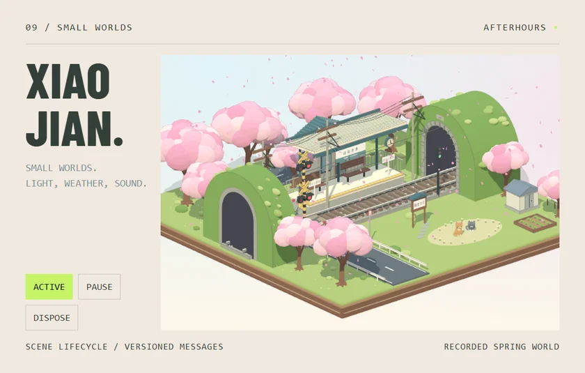](docs/readme/xiaojian-v2.gif)

[▶ View animation](docs/readme/xiaojian-v2.gif) · [Open live demo ↗](https://playertc5418-art.github.io/afterhours/sites/xiaojian/)

Step into small worlds built from geometry, lighting, weather, and sound, adjust the view, and return to the collection.

A React shell hosts isolated scene frames over a versioned message protocol that checks origin, sender window, and scene instance before accepting `ready`, mode, capture, or disposal messages. Scene transitions coordinate loading, opening, ready, and closing phases, while a bounded cache keeps two or three scene entries depending on the device branch, pauses inactive scenes, and sends a disposal request before retiring entries. Caching still carries memory cost, and disposal acknowledgements and timeouts are lifecycle guardrails rather than a guarantee of zero memory overhead.

## Prepare before the first interaction

[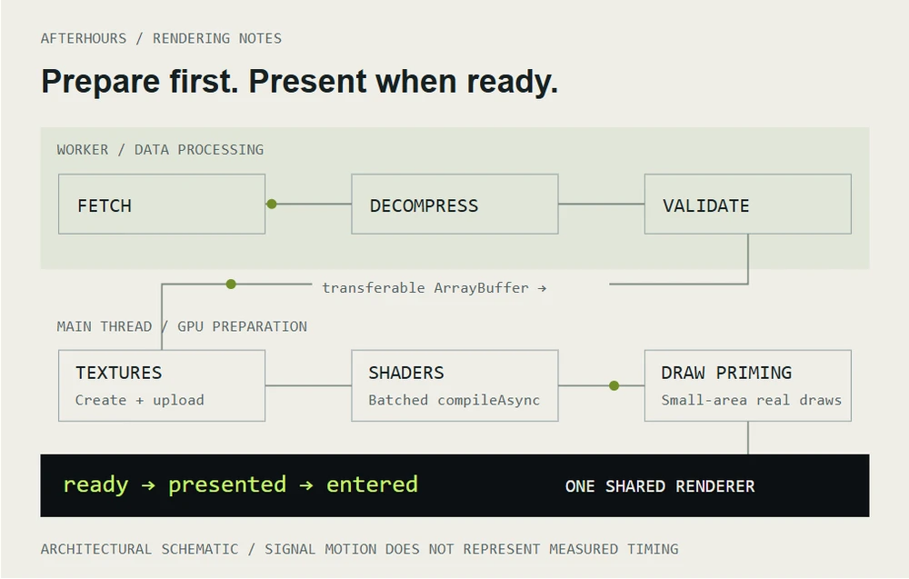](docs/readme/preparation-v2.svg)

1. **Offload separable work to a Worker.** The environment Worker fetches, validates, and decompresses baked environment data, returning `ArrayBuffer`s via transfer while texture creation and GPU upload stay on the main thread.
2. **Batch compilation and priming.** Representative material variants run `compileAsync` in batches, followed by small-viewport draw priming that restores visibility, render targets, viewports, and scissor state.
3. **Gate presentation on actual tasks.** Modules, fonts, scene construction, surfaces, shaders, and warm-up report progress across `ready → presented → entered`.
4. **Bound waiting and cancellation.** Environment and material requests can fall back after 15 seconds, `AbortSignal` propagates cancellation, and pause/background states factor into preparation timing.

These steps distribute work rather than guaranteeing a fixed frame rate or stutter-free playback on every device. See the [engineering notes](docs/ENGINEERING.md) for walkthroughs, reduced snippets, and trade-offs.

## Stack, with boundaries

| Building block | Where it is used |
| --- | --- |
| React · TypeScript · Vite | Page composition, state, and builds |
| Three.js · custom GLSL | Host architecture, Lab, Gravity Off, and miniature scenes |
| Native WebGL · GLSL | Standalone Singularity |
| GSAP · Lenis | Transitions, camera choreography, and scroll coordination |
| Rapier | Gravity Off rigid bodies and collisions |
| Web Audio | Distance-responsive mixing and scene sound |
| Worker · transferable ArrayBuffer | Environment-data preparation |

## Run the published version locally

```sh
git clone https://github.com/playertc5418-art/afterhours.git
cd afterhours
python -m http.server 8000

```

Open `http://localhost:8000/` in a WebGL-capable browser (`python3` or `py` may be required depending on your setup). This serves the static distribution; it does not rebuild a TypeScript source tree.

## Share the method. Improve the work.

Bug reports, device checks, documentation fixes, and experiment ideas are welcome. Share reproducible steps, separate observations from assumptions, and keep attribution intact when building on existing pieces. See [Contributing](CONTRIBUTING.md) or open an [Issue](https://github.com/playertc5418-art/afterhours/issues).

## Sources & acknowledgements

This site integrates third-party libraries, an adapted component, downloaded materials, and credited audio; walkthroughs document how they are wired together here rather than claiming original invention of every algorithm or effect. Full details live in [Credits](docs/CREDITS.md).

This repository holds static build output and documentation—not the full TypeScript development project or a site-wide open-source license. Reduced snippets in the engineering notes clarify mechanics rather than replacing source code, and third-party assets remain governed by their own terms.

Touch layouts, reduced motion, and WebGL fallbacks are implemented. Recorded checks cover Windows Chromium and mobile-size emulation, not every physical phone, Safari version, or low-end GPU. 智盾 SOC, HEMW, and CodeEdu–Trace appear as project stories; their backends and models do not run inside GitHub Pages.

Audio credits: **Meanwhile** by Scott Buckley ([attribution and license](https://playertc5418-art.github.io/afterhours/audio/credits.html)) and NASA/Chandra sonification ([credits](https://playertc5418-art.github.io/afterhours/sites/blackhole/audio/credits.html)). Font, material, and adapted-code notices are included in the distribution.
