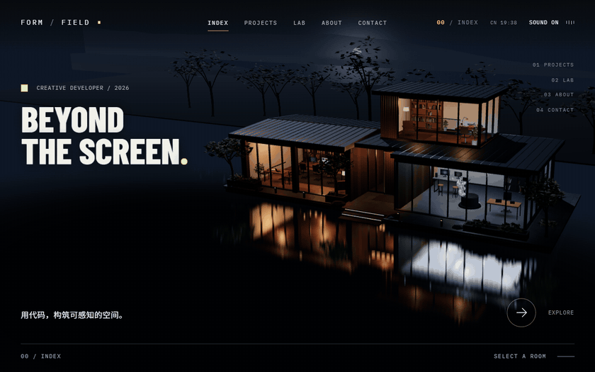
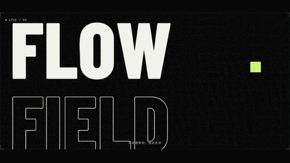
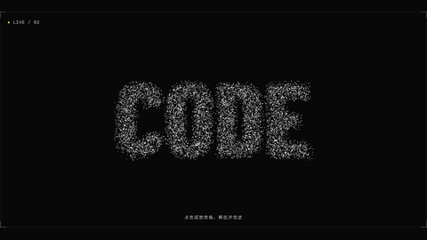
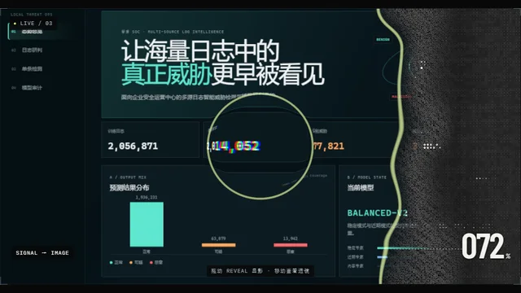
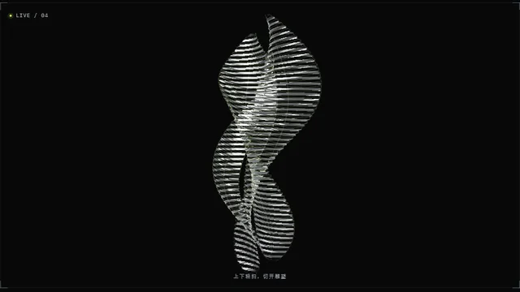
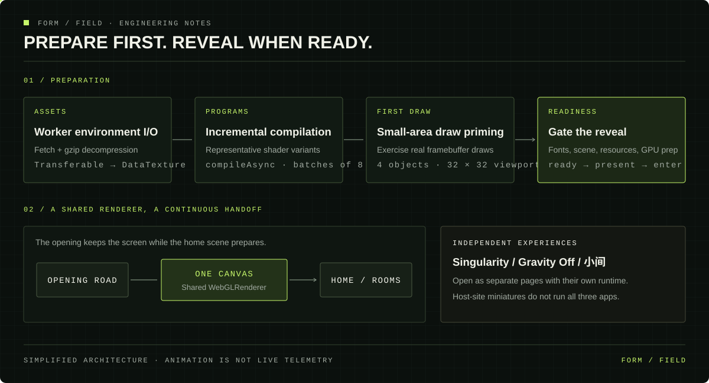
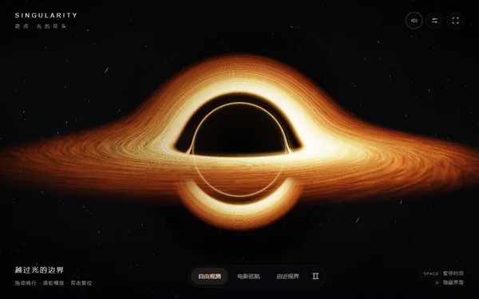
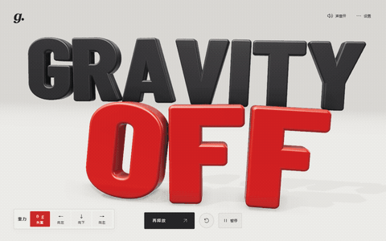

<h1 align="center">AFTERHOURS</h1>

<strong>Ideas take shape after dark.</strong> A nighttime workshop for spatial interfaces and real-time graphics.

<a href="https://playertc5418-art.github.io/afterhours/">Explore the website ↗</a> · <a href="docs/ENGINEERING.md">Engineering notes</a>

## An interface built as a place

Rooms are navigation. Objects lead into chapters. A nighttime building connects project stories, graphics experiments, and miniature worlds through camera movement and scene-to-DOM transitions.

Raycast proxies follow the scene's perspective. Room inspection and object activation use distinct states, coordinating camera, scroll, and focus before handing control to the page.

## Four graphics experiments

<table>
<tr>
<td width="50%" align="center">

 <strong>01 / TYPE · FLUID</strong>
</td>
<td width="50%" align="center">

 <strong>02 / PARTICLES</strong>
</td>
</tr>
<tr>
<td width="50%" align="center">

 <strong>03 / MEDIA REVEAL</strong>
</td>
<td width="50%" align="center">

 <strong>04 / MATERIAL STUDY</strong>
</td>
</tr>
</table>

- **Fluid typography.** A half-float ping-pong field combines semi-Lagrangian advection, pointer splats, and dissipation. The text shader samples velocity for UV displacement and RGB separation.
- **Particle morphing.** Precomputed text and sculpture targets live in buffer attributes. A vertex shader handles staggered interpolation, repulsion, and shockwaves; uniforms drive the animation.
- **Image reveal.** Luminance-shaped halftone dots transition into the source image. A pointer lens adds local refraction and chromatic separation.
- **Material study.** Solid, line, and point layers derive from one base form, sharing twist and clipping controls across five visual states.

## Prepared for the first interaction

- **One renderer across the opening and home scene.** A shared canvas changes ownership with explicit render-state restoration.
- **Worker-side environment preparation.** Fetch, validation, and decompression run off the main thread; transferred buffers become textures on the main thread.
- **Preparation in small batches.** Representative shader variants compile incrementally, followed by small-area draw priming. Resource tasks gate the reveal, with pause, cancellation, and fallback paths.

[Read the implementation and trade-offs →](docs/ENGINEERING.md)

## Three standalone worlds

<table>
<tr>
<td width="33%" align="center">

 <a href="https://playertc5418-art.github.io/afterhours/sites/blackhole/">SINGULARITY ↗</a>
</td>
<td width="33%" align="center">

 <a href="https://playertc5418-art.github.io/afterhours/sites/gravity-off/">GRAVITY OFF ↗</a>
</td>
<td width="33%" align="center">

 <a href="https://playertc5418-art.github.io/afterhours/sites/xiaojian/">小间 / XIAOJIAN ↗</a>
</td>
</tr>
</table>

**Singularity** pairs black-hole visuals with distance-responsive sound. **Gravity Off** combines Three.js and Rapier for draggable, releasable, reassemblable type. **Xiaojian** collects miniature scenes shaped by light, weather, and sound.

The main site displays their miniatures; each full experience opens in its own page and manages its own runtime.

<code>React</code> · <code>TypeScript</code> · <code>Three.js</code> · <code>GLSL</code> · <code>GSAP</code> · <code>Lenis</code>

<strong>Project stories, scope &amp; credits</strong>

The portfolio also presents **智盾 SOC**, **HEMW**, and **CodeEdu–Trace**, with implementation notes and evidence boundaries. Their backends and models do not run inside GitHub Pages.

This repository distributes the static site. Desktop and touch layouts, reduced motion, and WebGL fallback paths are implemented; recorded checks cover Windows Chromium and mobile-size emulation, rather than a complete physical-device matrix.

Previews are actual browser captures. The pipeline image is an architectural illustration. Shared-renderer claims apply to the opening and host site; Rapier belongs to the independent Gravity Off experience.

Music: **Meanwhile** by Scott Buckley — [attribution and license](https://playertc5418-art.github.io/afterhours/audio/credits.html). Singularity retains its NASA/Chandra sonification credits. Third-party font, code, and material notices remain with the site.

