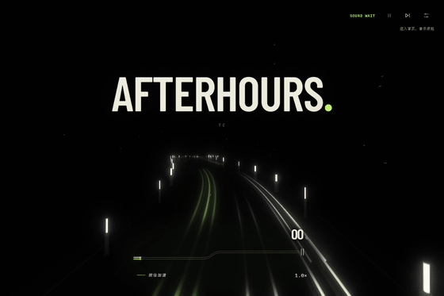
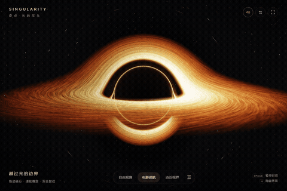
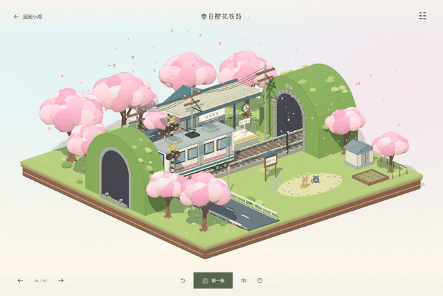

<p align="center">
<a href="README.md"></a>
<a href="README.zh-CN.md"></a>
</p>

<h1 align="center">AFTERHOURS</h1>

<p align="center"><strong>Ideas take shape after dark.</strong><br />A nighttime workshop for spatial interfaces and real-time graphics.</p>

<p align="center"><a href="https://playertc5418-art.github.io/afterhours/">Explore the website ↗</a> · <a href="docs/ENGINEERING.md">Engineering notes</a> · <a href="CONTRIBUTING.md">Contribute</a></p>

A portfolio you can move through, followed by the mechanics that make it work: spatial navigation, interactive shaders, GPU morphing, rendering preparation, and small worlds with explicit lifecycles.

All nine GIFs below are real browser captures, resized and sampled for reading rather than frame-rate measurement. The preparation diagram is an architectural illustration.

**Explore the mechanics:** [Spatial navigation](#spatial-navigation) · [Renderer handoff](#shared-renderer) · [Flow fields](#fluid-typography) · [GPU particles](#particle-morphing) · [Image reveal](#image-reveal) · [Material states](#material-study) · [Singularity](#singularity) · [Gravity Off](#gravity-off) · [Xiaojian](#xiaojian)

<a id="spatial-navigation"></a>

## 01 / Architecture as navigation

[](https://playertc5418-art.github.io/afterhours/)

Click a room to inspect it; return to the building without losing your place. Rooms and objects provide spatial entry points into the portfolio rather than decorative scenery.

- **How it works.** Three.js raycast proxies follow the scene’s perspective. A state machine separates overview, entry, inspection, and handoff; camera movement, scroll ownership, and DOM focus change together.
- **Why this approach.** A room can be inspected without immediately activating an object. Drag thresholds distinguish orbiting from clicking; Back and Escape provide a return path.
- **Try it.** Open a room, move around, activate an available object, and return. The GIF shows room entry and return; chapter handoff is explained in the engineering notes.

<a id="shared-renderer"></a>

## 02 / One renderer, two experiences

[](https://playertc5418-art.github.io/afterhours/)

The road opening hands control to a nighttime workshop. The interesting part is the boundary between two rendering systems, not just the transition animation.

- **How it works.** A shared RenderHost owns the opening and home WebGLRenderer. The handoff restores render target, viewport, scissor, color space, tone mapping, exposure, and shadow settings before the home scene takes over.
- **Why this approach.** Preparation can run before the reveal without creating a second host context. Shared state also requires explicit cleanup: a renderer setting left behind by one scene can break the next.
- **Scope.** This applies to the opening and host site. Independent worlds have separate runtimes. The opening is adapted from React Bits Hyperspeed; provenance and licenses remain with the distribution.

<a id="fluid-typography"></a>

## 03 / Fluid typography

[](https://playertc5418-art.github.io/afterhours/#lab)

Move the pointer through the text. Letterforms bend, split into color channels, and gradually settle as the injected force fades.

- **How it works.** Two half-float render targets alternate between reading and writing. Semi-Lagrangian backtracing advects the previous field; a Gaussian pointer splat injects force. The display shader uses that field for UV displacement and RGB separation.
- **Why this approach.** A 256 × 144 desktop field keeps the simulation grid independent of display resolution. The full-screen display pass still scales with the viewport; this is not a claim of constant total GPU cost.
- **Boundary.** This is an interactive flow field, without a complete divergence/pressure/projection solver. Unsupported float targets use an analytical pointer ripple.

<a id="particle-morphing"></a>

## 04 / GPU particle morphing

[](https://playertc5418-art.github.io/afterhours/#lab)

One point cloud turns into CODE, FORM, and a sculpture. Moving the pointer pushes particles away; a click sends an expanding shockwave through the shape.

- **How it works.** Text sampling and sculpture geometry supply target positions. Buffer attributes store shape targets, scatter directions, and random seeds. The vertex shader combines staggered interpolation, pointer repulsion, and radial impulses.
- **Why this approach.** The CPU updates uniforms rather than uploading every particle position each frame. The configured counts are 10,000 on desktop and 4,200 on the mobile branch; sampling and buffer creation still require preparation.
- **Try it.** Switch targets, adjust DISPERSE, and trigger IMPULSE with a click or the keyboard.

<a id="image-reveal"></a>

## 05 / From signal to image

[](https://playertc5418-art.github.io/afterhours/#lab)

A picture emerges through noise, grid, and halftone stages. A local lens bends the revealed image beneath the pointer.

- **How it works.** Image luminance controls dot size inside a grid. A scan front blends the signal stages into the original image; pointer distance controls UV refraction and chromatic separation.
- **Why this approach.** One image drives both the halftone representation and the final reveal. Aspect-aware cover sampling keeps the image framed as the panel changes shape.
- **Boundary.** The lens is a screen-space shader effect, not a physically traced glass object. Drag REVEAL to inspect the transition instead of waiting for a preset animation.

<a id="material-study"></a>

## 06 / One form, five material states

[](https://playertc5418-art.github.io/afterhours/#lab)

Move between solid, wire, sliced, point, and X-ray views. The form remains recognizable while its surface, structure, and interior are exposed differently.

- **How it works.** Solid, line, and point representations derive from a shared base form. Their shaders coordinate twist, time, clipping, opacity, and pointer input; invisible layers stop drawing.
- **Why this approach.** Keeping deformation inputs aligned prevents the representations from drifting apart. Derived line and point geometry still consumes memory: this is not literally one geometry object for all layers.
- **Try it.** Switch all five states and adjust TWIST. The animation records those controls in the real browser.

<a id="singularity"></a>

## 07 / SINGULARITY — bending light and shaping sound

[](https://playertc5418-art.github.io/afterhours/sites/blackhole/)

Orbit a luminous accretion disk, change the palette, or approach the apparent horizon. The visual system and sound mix respond to the same camera distance.

- **How it works.** The standalone app uses native WebGL and custom GLSL. A fragment shader steps an approximately curved ray, accumulates accretion-disk contributions, and samples a procedural sky. A second pass reconstructs highlights for bloom and tone mapping.
- **Sound.** Web Audio smoothly changes gain and low-pass cutoff with distance. An attributed NASA/Chandra sonification recording is mixed with a synthesized ambience; GIF previews are silent.
- **Boundary.** This is an artistic approximation inspired by black-hole imagery, not a validated general-relativity simulation. Resolution budgets and frame-time sampling can reduce rendering quality under load.

<a id="gravity-off"></a>

## 08 / GRAVITY OFF — typography with a body

[](https://playertc5418-art.github.io/afterhours/sites/gravity-off/)

Release the letters, drag them through space, change gravity, and assemble the composition again. The moving type has collision shapes and rigid-body state.

- **How it works.** Three.js renders extruded glyphs; Rapier simulates compound convex-hull colliders. A 1/60-second physics step is accumulated separately from display frames, with a cap on catch-up steps.
- **Why this approach.** Dynamic bodies handle release and collision. Kinematic bodies guide reassembly back to stored home poses, separating free motion from an intentional return.
- **Boundary.** Physics belongs to this standalone experience. The miniature visible on the main-site desk does not run a second copy of the full simulation.

<a id="xiaojian"></a>

## 09 / XIAOJIAN — miniature worlds with a lifecycle

[](https://playertc5418-art.github.io/afterhours/sites/xiaojian/)

A collection of small worlds built from geometry, lighting, weather, and sound. Enter a scene, change the view, then return to the collection.

- **How it works.** A React shell hosts independent scene frames. A versioned message protocol checks origin, source window, and scene instance before accepting readiness, mode, capture, or disposal messages.
- **Why this approach.** Scene switching coordinates loading, opening, ready, and closing phases. A bounded cache keeps two or three scene entries according to the device branch; inactive scenes are paused, and retired entries receive a disposal request.
- **Boundary.** Cached scenes still have resource costs. Disposal acknowledgement and timeout handling are lifecycle safeguards, not a promise of zero memory use.

## Prepare before the first interaction


1. **Move separable work off the main thread.** A Worker fetches, validates, and decompresses environment data, then transfers ArrayBuffers back. Texture creation and GPU upload remain on the main thread.
2. **Prepare in batches.** Representative material variants call `compileAsync` incrementally, followed by real small-viewport draw priming. Preparation restores visibility, targets, viewports, and scissor state.
3. **Gate presentation on actual tasks.** Modules, fonts, scene, surfaces, shaders, and warm-up report progress; `ready → presented → entered` distinguishes preparation from presentation and entry.
4. **Keep a way forward.** Environment and material requests can fall back after 15 seconds; AbortSignal carries cancellation, while pause and background state participate in preparation timing.

These choices distribute or relocate work. They do not guarantee a fixed frame rate or a stutter-free result on every device.

[Read the implementation walkthrough, reduced examples, and trade-offs →](docs/ENGINEERING.md)

## Stack, with boundaries

| Building block | Where it is used |
| --- | --- |
| React · TypeScript · Vite | Page composition, state, and builds |
| Three.js · custom GLSL | Host architecture, Lab, Gravity Off, and miniature scenes |
| Native WebGL · GLSL | Standalone Singularity |
| GSAP · Lenis | Transitions, camera choreography, and scroll coordination |
| Rapier | Gravity Off rigid bodies and collisions |
| Web Audio | Distance-responsive mixing and scene sound |
| Worker · transferable ArrayBuffer | Environment-data preparation |

## Run the published version locally

```sh
git clone https://github.com/playertc5418-art/afterhours.git
cd afterhours
python -m http.server 8000
```

Open `http://localhost:8000/`. Requires Git, Python, and a WebGL-capable browser; your Python command may be `python3` or `py`. This serves the published static website; it does not rebuild the TypeScript project.

## Share the method. Improve the work.

Bug reports, device checks, documentation improvements, and experiment proposals are welcome. Describe reproducible steps, distinguish observations from assumptions, and preserve attribution when building on a technique.

[Contribution guide](CONTRIBUTING.md) · [Issues](https://github.com/playertc5418-art/afterhours/issues)

<details>
<summary><strong>Distribution, validation, and credits</strong></summary>

This repository currently contains static output and technical documentation, rather than the complete development project or a blanket open-source code license. Reduced examples in the notes explain algorithms; they are not a replacement for the full source. Third-party assets retain their own terms; public visibility does not grant unrestricted reuse of every asset.

Touch layouts, reduced motion, and WebGL fallback paths are implemented. Recorded acceptance covers Windows Chromium and mobile-size emulation, not every physical phone, Safari version, or low-end GPU. 智盾 SOC, HEMW, and CodeEdu–Trace are project stories; their backends and models do not execute inside GitHub Pages.

Music: **Meanwhile** by Scott Buckley — [attribution and license](https://playertc5418-art.github.io/afterhours/audio/credits.html). Singularity: [NASA/Chandra sonification credits](https://playertc5418-art.github.io/afterhours/sites/blackhole/audio/credits.html). Font, material, and adapted-code notices remain in the distribution.

</details>
