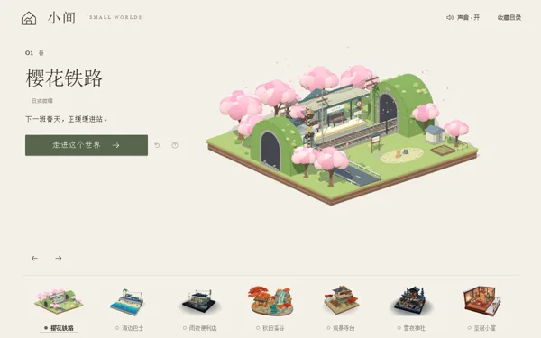

# FORM / FIELD

**用代码，构筑可感知的空间。**

实时三维场景 · 空间交互 · 渲染调度 · 声音叙事

[进入网站 ↗](https://playertc5418-art.github.io/form-field/) · [技术拆解](docs/ENGINEERING.md) · [探索三个作品](#三个独立作品)

`React 19`　`TypeScript`　`Three.js`　`GSAP`　`Lenis`

实际页面录屏：建筑总览 → 进入房间 → 返回。GIF 为取样预览，完整交互请进入网站。

FORM / FIELD 是我的个人数字作品集。我把导航放进一座可以探索的夜间建筑，让房间、物件与页面内容相互接力：从空间里发现作品，再进入案例、视觉实验和微缩世界。

## 空间如何成为界面

- **建筑里的导航**：用 Raycaster 命中空间代理，聚焦对应房间；点击内部物件后，继续进入项目、实验或个人空间。支持拖拽环视、返回和键盘操作。
- **三维与页面接力**：相机、物件姿态和 DOM 内容围绕同一段旅程编排，让房间中的展示屏、实验装置与后续章节产生连续关系。
- **可以亲手操作的实验**：流体文字、粒子、媒体揭示与材质研究，把视觉效果和原理说明放在一起。
- **具体的项目实践**：智盾 SOC、HEMW、CodeEdu–Trace 的案例包含实现思路、技术取舍与验证范围。

## 画面背后的工程

架构示意；移动节点用于说明流程，不代表实时性能或实际耗时。

| 技术点 | 具体实现 |
| :--- | :--- |
| **开场与主站共享 renderer** | 使用一个 `WebGLRenderer`，在开场和建筑首页之间切换渲染配置、交接同一块 canvas；开场仍在屏幕上时，主站已开始准备。 |
| **Worker 环境数据准备** | 在 Worker 中读取、解压烘焙环境数据，通过可转移缓冲区交回主线程，再构建 HalfFloat `DataTexture`。Worker 不创建 WebGL context。 |
| **分帧编译与首次绘制预热** | 按材质与顶点布局选取代表对象，分批调用 `compileAsync`；再在 `32 × 32` 区域分批执行真实绘制，提前准备首次使用所需的图形状态。 |
| **真实任务驱动的加载状态** | 模块、字体、场景、表面资源、Shader 与预热分别记录进度；资源准备和进入状态分开管理，失败资源可记录回退。 |
| **按场景安排生命周期** | 主站展台展示微缩模型；三个完整作品通过独立页面打开，各自管理渲染、声音与物理，不在主站同时运行全部独立应用。 |

[阅读实现细节与设计取舍 →](docs/ENGINEERING.md)

## 三个独立作品

<table>
<tr>
<td width="33%" valign="top">

**奇点 · SINGULARITY**

黑洞视觉与距离联动声景。镜头靠近时，声音的强度与音色一起变化，让距离也能被听见。

`Three.js` · `Web Audio`

[进入奇点 ↗](https://playertc5418-art.github.io/form-field/sites/blackhole/)

</td>
<td width="33%" valign="top">

**GRAVITY OFF**

把文字变成可操作的三维物体。释放、拖动、改变重力与重新组装，探索字形和物理之间的关系。

`Three.js` · `Rapier`

[进入失重 ↗](https://playertc5418-art.github.io/form-field/sites/gravity-off/)

</td>
<td width="33%" valign="top">

**小间 · 微缩世界收藏室**

把铁路、海边、雨夜、神社与圣诞小屋收藏进浏览器，让光线、天气和声音参与空间叙事。

`WebGL` · `Scene Design`

[进入小间 ↗](https://playertc5418-art.github.io/form-field/sites/xiaojian/)

</td>
</tr>
</table>

<strong>适配、验证与项目说明</strong>

- 为桌面与触屏提供相应布局，并处理减少动态效果、WebGL 不可用、加载失败和重试状态。
- 主站案例弹层处理焦点返回、原生滚动及图片查看；动画准备流程包含暂停、取消和延迟释放处理。
- 当前发布检查覆盖 Windows Chromium 桌面和手机尺寸模拟。模拟结果不代表真实手机、Safari 或低端 GPU 的表现，也不承诺所有设备固定帧率。
- 本仓库用于发布网站的静态产物；技术拆解介绍对应实现，不提供源码工程的安装命令。

<strong>素材与许可</strong>

第三方代码、字体、音乐及素材的来源和许可随站点保留，相关记录见 [licenses](licenses/)、[材质记录](materials/atelier/) 及各独立作品目录。

背景音乐：Scott Buckley — **Meanwhile**。[作者与许可署名](https://playertc5418-art.github.io/form-field/audio/credits.html)。黑洞声景的来源与署名保留在奇点作品内。

本 README 的体验预览录自当前发布页面；渲染流程图为实现关系的示意。

