<p align="center">
<a href="README.md"></a>
<a href="README.zh-CN.md"></a>
</p>

<h1 align="center">AFTERHOURS</h1>

<p align="center"><strong>Ideas take shape after dark.</strong><br />入夜，让想法成形。</p>

<p align="center"><a href="https://playertc5418-art.github.io/afterhours/">进入网站 ↗</a> · <a href="docs/ENGINEERING.zh-CN.md">工程笔记</a> · <a href="docs/CREDITS.zh-CN.md">来源与署名</a> · <a href="CONTRIBUTING.zh-CN.md">参与贡献</a></p>

[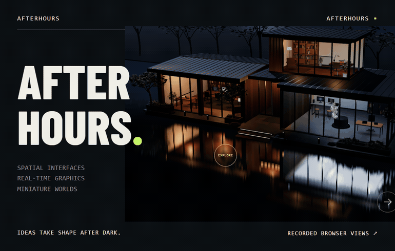](https://playertc5418-art.github.io/afterhours/)

这是一个可穿梭的空间作品集，也是一组图形与交互工程实验：建筑空间导航、交互着色器、GPU 粒子变形、揭幕前的分批准备，以及带完整生命周期的小世界。

封面与下方九段技术动图将真实浏览器画面与说明图示组合。示意部分用于解释实现，抽帧预览不用于测量帧率；流程图是架构示意。

**浏览路线：** [空间导航](#spatial-navigation) · [渲染器接力](#shared-renderer) · [流体文字](#fluid-typography) · [GPU 粒子](#particle-morphing) · [图像显影](#image-reveal) · [材质实验](#material-study) · [奇点](#singularity) · [失重文字](#gravity-off) · [小间](#xiaojian)

<a id="spatial-navigation"></a>

## 01 / 用建筑组织导航

[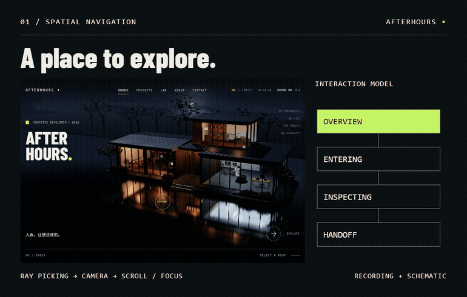](https://playertc5418-art.github.io/afterhours/)

房间与内部物件就是内容入口：点进房间检视空间，再回到建筑总览，不用丢失当前上下文。

Three.js 射线代理随场景透视投影变化，让命中区域贴合画面视角。状态机把 `overview`、`entering`、`inspecting` 和 `handoff` 拆开，统一联动相机位移、滚动归属和 DOM 焦点；拖拽阈值用来区分环视与点击，返回按钮和 `Escape` 随时退出检视。进房间、看物件再退回总览即可体验；章节接力的细节见[工程笔记](docs/ENGINEERING.zh-CN.md)。

<a id="shared-renderer"></a>

## 02 / 开场与首页共享渲染器

[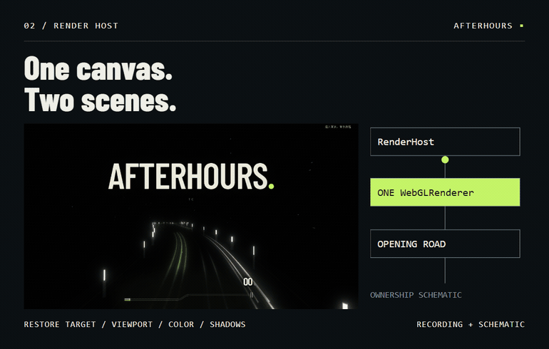](https://playertc5418-art.github.io/afterhours/)

光轨开场把画布交给夜间工坊，开场与建筑主站共用 `RenderHost` 创建的同一份 `WebGLRenderer`。提前准备主站场景省去了另建主渲染上下文的开销，但交接时必须恢复 render target、viewport、scissor、色彩空间、tone mapping、曝光和阴影状态，防止前一阶段的配置串到下一阶段。

渲染器共享仅限开场与主站，独立作品各自维护运行时。开场道路与光轨改编自 **David Haz / React Bits 的 [Hyperspeed](https://github.com/DavidHDev/react-bits/blob/e12c22192ac7b4b452c5e2feb9b586d74765d696/src/content/Backgrounds/Hyperspeed/Hyperspeed.jsx)**（锁定版本许可为 MIT + Commons Clause；详见[来源、许可与本地改动](docs/CREDITS.zh-CN.md)）。

<a id="fluid-typography"></a>

## 03 / 可以搅动的流体文字

[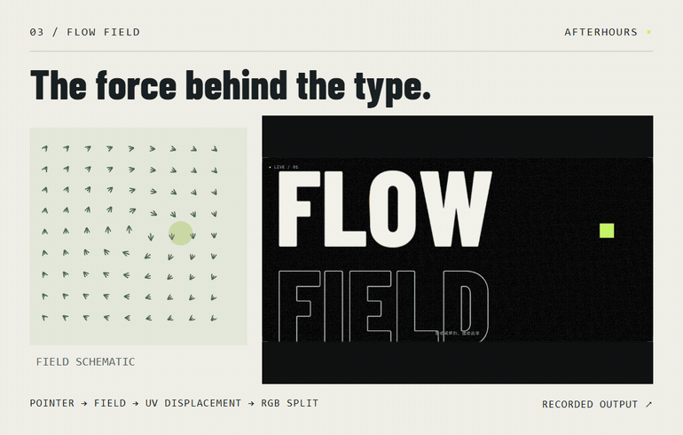](https://playertc5418-art.github.io/afterhours/#lab)

左侧为概念流场示意，右侧为实际显示效果录屏。

在文字上滑动指针，字形随之弯曲并产生 RGB 色散，扰动随衰减慢慢平息。

两张半浮点 render target 交替读写：半拉格朗日回溯搬运上一帧速度场，高斯指针笔刷注入局部推力，显示着色器再据此偏移 UV 并分离 RGB 通道。桌面流场网格设为 `256 × 144`，把场更新分辨率与显示分辨率分开，不过全屏显示 pass 仍会随视口尺寸变化。这里做的是简化交互流场，不包含完整的散度、压力与投影求解；缺少所需浮点渲染目标时，会回退到解析式指针涟漪。

<a id="particle-morphing"></a>

## 04 / GPU 粒子形变

[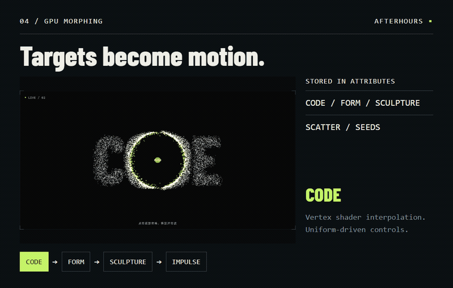](https://playertc5418-art.github.io/afterhours/#lab)

同一批粒子在 `CODE`、`FORM` 与雕塑形体之间切换，指针会把粒子推开，点击则激起向外扩散的冲击波。

Canvas2D 字形采样与雕塑几何提供目标点位，写入顶点缓冲属性，并附带散射方向与逐粒子随机种子。顶点着色器在 GPU 端完成错峰插值、指针排斥与径向冲击波，CPU 通过 uniform 传入当前动画参数，不必逐帧重传全部粒子坐标。桌面配置为 `10,000` 颗粒子，移动分支为 `4,200` 颗，采样与缓冲构建仍在准备阶段完成。切换目标、调节 `DISPERSE`，再点击或在实验面板中按空格或回车触发 `IMPULSE`。

<a id="image-reveal"></a>

## 05 / 从信号到图像的显影

[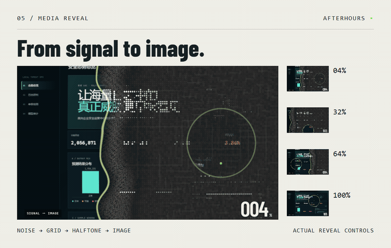](https://playertc5418-art.github.io/afterhours/#lab)

画面从噪波、网格与半色调点阵逐步显影，指针经过处还会叠加局部透镜效果。

原图亮度决定网格内圆点大小，扫描前沿把信号阶段过渡到原图，指针距离则控制 UV 折射与色散。同一张图片同时驱动半色调与最终显影，并按宽高比做 cover 采样以适应面板尺寸变化。透镜属于屏幕空间着色效果，不是真实玻璃光线追踪；拖动 `REVEAL` 就能直接查看各阶段变化。

<a id="material-study"></a>

## 06 / 一个形体，五种材质状态

[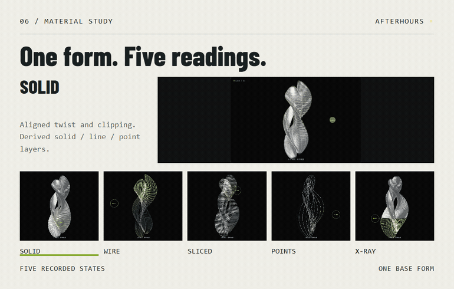](https://playertc5418-art.github.io/afterhours/#lab)

在实体、线框、切片、点云与 X 光五种状态间切换，从表层、结构到内部观察同一个形体。

实体、线与点均由同一基础形体派生，着色器同步扭转、时间、剖切、透明度与指针参数，不可见图层停止绘制。派生线框和点云几何仍会占用额外内存，并非所有图层共用单一几何对象。动图记录了在真实浏览器中切换五种状态的操作；可以在实际页面调节 `TWIST`，继续观察形变。

<a id="singularity"></a>

## 07 / 奇点：弯曲的光与距离联动的声音

[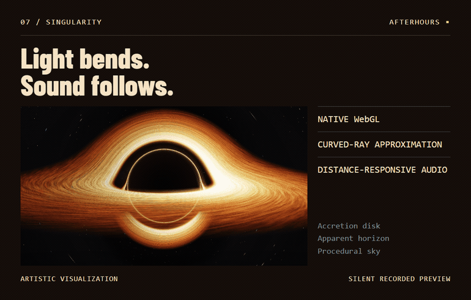](https://playertc5418-art.github.io/afterhours/sites/blackhole/)

绕行吸积盘、切换配色或靠近视界时，画面与声音混音都会随相机距离变化。

独立页面使用原生 WebGL 与自定义 GLSL：片元着色器沿近似弯曲的光线步进，累积吸积盘亮度并采样程序化星空，再经第二道 pass 重建高光、做辉光与色调映射。Web Audio 按距离平滑调整增益与低通截止频率，将带署名的 NASA/Chandra 声化录音与合成氛围声混合（GIF 无声）。这是受黑洞可视化启发的艺术近似，不是广义相对论科学仿真，高负载下分辨率预算与帧耗时采样会主动降低画质。

<a id="gravity-off"></a>

## 08 / GRAVITY OFF：有重量的文字

[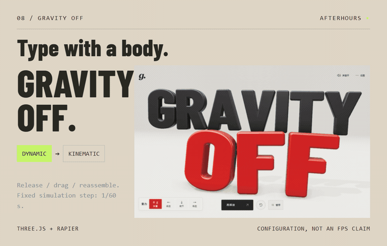](https://playertc5418-art.github.io/afterhours/sites/gravity-off/)

把字母释放到空间中拖拽、切换重力，再重新拼回构图。

Three.js 渲染挤出字形，Rapier 模拟复合凸包碰撞体，物理步长固定为 `1/60` 秒，与显示帧分开累计并限制单帧追赶步数。动态刚体负责释放与碰撞，运动学刚体则按保存的初始位姿引导重组。物理模拟属于该独立页面，主站桌面的微缩展品不会重复跑整套物理。

<a id="xiaojian"></a>

## 09 / 小间：有生命周期的微缩世界

[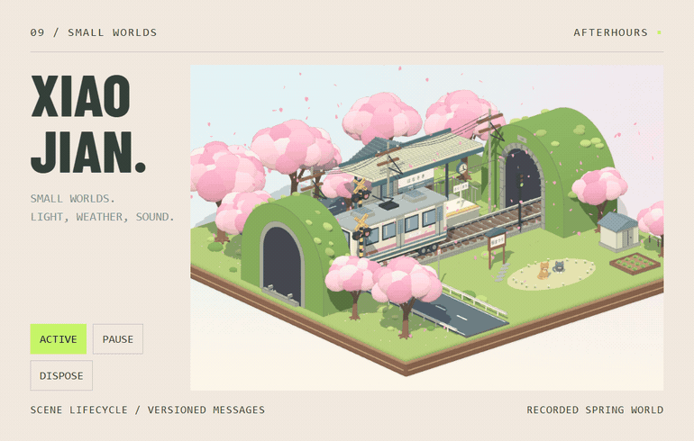](https://playertc5418-art.github.io/afterhours/sites/xiaojian/)

走进由几何、光照、天气与声音拼成的小世界，换个视角再回到收藏列表。

React 外壳通过带版本的消息协议与独立场景 iframe 通信，校验来源、发送窗口与场景实例后才接收 `ready`、模式、拍照或释放消息。切换流程经过加载、展开、就绪与收起阶段；缓存按设备分支保留两到三个条目，非活跃场景暂停，淘汰前先发释放请求。缓存仍有资源占用，释放确认与超时只是生命周期兜底，不代表内存归零。

## 在第一次交互前完成准备

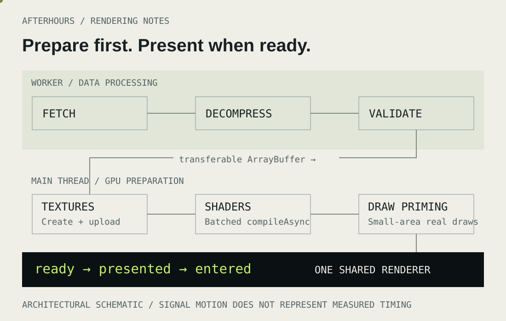

1. **把可抽离的数据处理放进 Worker。** 环境 Worker 拉取、校验并解压烘焙环境数据，通过可转移 `ArrayBuffer` 回传；纹理创建与 GPU 上传仍在主线程完成。
2. **分批编译与小视口预热。** 代表性材质变体分批调用 `compileAsync`，随后在 `32 × 32` 小视口执行真实绘制预热，并恢复可见性、render target、viewport 与 scissor 状态。
3. **按真实任务进度决定揭幕。** 模块、字体、场景、表面资源、着色器与预热各自上报进度，按 `ready → presented → entered` 推进状态。
4. **设置超时回退与取消边界。** 环境与材质请求等待 15 秒可走回退路径，取消通过 `AbortSignal` 传递，暂停与后台状态也会参与准备计时。

这些做法用于拆分和前移工作，不承诺固定帧率或所有设备无卡顿。更多实现细节、简化代码与取舍见[工程笔记](docs/ENGINEERING.zh-CN.md)。

## 技术栈与适用位置

| 组成 | 用在什么地方 |
| --- | --- |
| React · TypeScript · Vite | 页面组织、状态与构建 |
| Three.js · 自定义 GLSL | 主站空间、Lab、失重文字及微缩场景 |
| 原生 WebGL · GLSL | 奇点独立页面 |
| GSAP · Lenis | 过渡、镜头与滚动协调 |
| Rapier | GRAVITY OFF 的刚体与碰撞 |
| Web Audio | 独立作品的距离混音与场景声音 |
| Worker · transferable ArrayBuffer | 环境数据准备 |

## 在本地查看发布版本

```sh
git clone https://github.com/playertc5418-art/afterhours.git
cd afterhours
python -m http.server 8000

```

在支持 WebGL 的浏览器中打开 `http://localhost:8000/`（部分环境需使用 `python3` 或 `py`）。这里启动的是已发布的静态文件，不包含 TypeScript 源码重构建流程。

## 分享方法，也欢迎改进

欢迎提交问题复现、设备测试反馈、文档修正或实验想法。描述问题时附上可复现步骤，把观察结果与推测分开；借鉴或复用思路时请保留作者与第三方素材署名。详见[贡献指南](CONTRIBUTING.zh-CN.md)或前往 [Issues](https://github.com/playertc5418-art/afterhours/issues)。

## 来源与致谢

网站集成了第三方库、改编组件、下载材质与带署名的音频；技术说明记录的是集成与实现方式，不代表所有算法或视觉效果都由本项目原创。完整清单见[来源与署名](docs/CREDITS.zh-CN.md)。

当前仓库存放的是静态发布产物与说明文档，不是完整 TypeScript 开发工程，也未声明覆盖整站的开源许可证。工程笔记中的缩减代码用于说明原理而非替代源码；第三方素材各自沿用原有授权。

触屏布局、减少动态与 WebGL 回退均已实现。记录的验收覆盖 Windows Chromium 与手机尺寸模拟，不包括全部真机、Safari 版本或低端 GPU。智盾 SOC、HEMW 与 CodeEdu–Trace 为项目案例展示，其后端与模型不在 GitHub Pages 中运行。

音频署名：Scott Buckley 的 **Meanwhile**（[署名与许可](https://playertc5418-art.github.io/afterhours/audio/credits.html)）与 NASA/Chandra 声化素材（[署名说明](https://playertc5418-art.github.io/afterhours/sites/blackhole/audio/credits.html)）。字体、材质与改编代码声明随发布文件一并保留。
