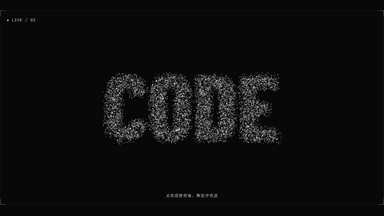
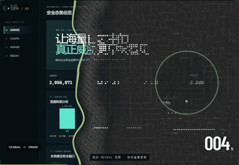
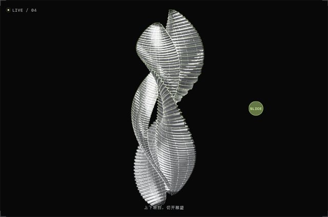

<p align="center">
<a href="README.md"></a>
<a href="README.zh-CN.md"></a>
</p>

<h1 align="center">AFTERHOURS</h1>

<p align="center"><strong>Ideas take shape after dark.</strong><br />入夜，让想法成形。</p>

<p align="center"><a href="https://playertc5418-art.github.io/afterhours/">进入网站 ↗</a> · <a href="docs/ENGINEERING.zh-CN.md">工程笔记</a> · <a href="CONTRIBUTING.zh-CN.md">参与贡献</a></p>

这里不只展示结果，也分享结果怎样产生：空间如何成为导航，文字如何被流场搅动，粒子怎样在 GPU 上变形，以及场景如何准备、接力与释放。

下面的九段 GIF 均来自真实浏览器操作；为阅读而缩放、抽帧，不能用来衡量帧率。渲染准备图是架构示意。

**浏览路线：** [空间导航](#spatial-navigation) · [渲染器接力](#shared-renderer) · [流体文字](#fluid-typography) · [GPU 粒子](#particle-morphing) · [图像显影](#image-reveal) · [材质实验](#material-study) · [奇点](#singularity) · [失重文字](#gravity-off) · [小间](#xiaojian)

<a id="spatial-navigation"></a>

## 01 / 用建筑组织导航

[](https://playertc5418-art.github.io/afterhours/)

点击房间进入检视，再返回建筑总览。房间和物件承担内容入口，空间本身参与导航。

- **实现思路。** Three.js 射线命中代理随场景透视变化；状态机区分总览、进入、检视与章节接力，统一协调相机、滚动控制和 DOM 焦点。
- **设计取舍。** 先看房间，再决定是否激活物件。拖动阈值区分旋转与点击，返回按钮和 Escape 提供退出路径。
- **动手体验。** 进入房间、观察物件，再返回总览。动图展示房间进出，章节接力的处理见工程笔记。

<a id="shared-renderer"></a>

## 02 / 开场与首页共享渲染器

[](https://playertc5418-art.github.io/afterhours/)

光轨开场把视线交给夜间工坊。这里的重点除了动画，还包括两套渲染逻辑如何交接同一个画布。

- **实现思路。** RenderHost 管理开场与首页共用的 WebGLRenderer。接力时恢复渲染目标、视口、裁剪区、色彩空间、色调映射、曝光与阴影设置，再由首页接管画布。
- **设计取舍。** 在揭幕前准备首页，无需为主站另建一份渲染上下文；代价是必须明确恢复渲染状态，避免上一场景遗留设置影响下一场景。
- **适用范围。** 共享范围仅为开场与主站，独立作品各自管理运行时。开场基于 React Bits Hyperspeed 改编，发行文件保留来源与许可证。

<a id="fluid-typography"></a>

## 03 / 可以搅动的流体文字

[](https://playertc5418-art.github.io/afterhours/#lab)

移动指针，文字随流场弯曲、产生色散，注入的扰动力逐渐衰减，画面重新平静。

- **实现思路。** 两张半浮点渲染目标交替读写。半拉格朗日回溯搬运上一帧的场，高斯形状的指针注入局部力，显示着色器再用流场推动 UV 并分离 RGB 通道。
- **设计取舍。** 桌面流场网格为 256 × 144，模拟分辨率与显示分辨率分开；最终的全屏绘制仍受视口大小影响，不能把它说成整体 GPU 成本恒定。
- **能力边界。** 这是交互流场，没有完整的散度、压力与投影求解流程；浮点渲染目标不可用时，退回解析式指针波纹。

<a id="particle-morphing"></a>

## 04 / GPU 粒子形变

[](https://playertc5418-art.github.io/afterhours/#lab)

同一批粒子在 CODE、FORM 与雕塑之间变形。指针把粒子推开，点击则沿形体释放一圈扩散冲击波。

- **实现思路。** 文字采样和雕塑几何提供目标点集；缓冲属性保存目标坐标、散射方向与随机种子，顶点着色器组合逐粒子延迟、指针排斥和径向冲量。
- **设计取舍。** CPU 每帧更新 uniform，不逐粒子重传坐标。配置为桌面 10,000 粒子、移动分支 4,200 粒子；目标采样与缓冲创建仍需在准备阶段完成。
- **动手体验。** 切换目标，调节 DISPERSE，并通过点击或键盘触发 IMPULSE。

<a id="image-reveal"></a>

## 05 / 从信号到图像的显影

[](https://playertc5418-art.github.io/afterhours/#lab)

图像经过噪波、网格、半色调点阵逐渐显影，指针下方的局部透镜继续改变图像采样。

- **实现思路。** 图像亮度决定网格内的圆点大小，扫描前沿把信号状态混合为原图，指针距离控制 UV 折射与边缘色散。
- **设计取舍。** 同一张图片同时驱动半色调和最终画面；按宽高比计算 cover 采样，面板变形时仍保持合理构图。
- **能力边界。** 透镜属于屏幕空间着色效果，并非真实玻璃的物理光线追踪。拖动 REVEAL 可直接检查整个显影过程。

<a id="material-study"></a>

## 06 / 一个形体，五种材质状态

[](https://playertc5418-art.github.io/afterhours/#lab)

在实体、线框、切片、点云与 X 光状态之间切换，同一形体以不同方式暴露表面、结构和内部。

- **实现思路。** 实体、线与点表示从同一基础形体派生；着色器同步扭转、时间、剖切、透明度和指针输入，不可见层停止参与绘制。
- **设计取舍。** 统一变形输入，避免不同表示在动画中错位。派生线和点的几何仍占用内存，不能声称所有图层只用一个几何对象。
- **动手体验。** 依次切换五种状态，再调节 TWIST。这里的动图录制了真实浏览器控件操作。

<a id="singularity"></a>

## 07 / 奇点：弯曲的光与距离联动的声音

[](https://playertc5418-art.github.io/afterhours/sites/blackhole/)

环绕吸积盘、切换配色，或接近视觉上的视界。画面观察距离同时参与声音混音。

- **实现思路。** 独立页面使用原生 WebGL 与自定义 GLSL。片元着色器沿近似弯曲的光线步进，累积吸积盘贡献并采样程序化星空，第二个 pass 重建高光并完成辉光与色调映射。
- **声音设计。** Web Audio 随距离平滑调节增益和低通截止频率，将带署名的 NASA/Chandra 声化录音与合成氛围层混合。GIF 本身没有声音。
- **能力边界。** 这是受黑洞影像启发的艺术近似，不是经过验证的广义相对论仿真。分辨率预算和帧耗时采样可在负载升高时降低画质。

<a id="gravity-off"></a>

## 08 / GRAVITY OFF：有重量的文字

[](https://playertc5418-art.github.io/afterhours/sites/gravity-off/)

释放字母、拖拽、改变重力，再把构图重新组装起来。文字的运动由碰撞形状和刚体状态参与控制。

- **实现思路。** Three.js 绘制挤出的字形，Rapier 使用复合凸包碰撞体进行仿真。物理采用 1/60 秒固定步长，与显示帧分开累计，并限制单帧追赶步数。
- **设计取舍。** 动态刚体处理释放与碰撞，运动学刚体负责按保存的初始姿态引导重组，区分自由运动与有意设计的归位。
- **适用范围。** 物理引擎属于这个独立作品，主站桌面上的微缩展品没有重复运行完整仿真。

<a id="xiaojian"></a>

## 09 / 小间：有生命周期的微缩世界

[](https://playertc5418-art.github.io/afterhours/sites/xiaojian/)

用几何、光照、天气与声音构建的小世界收藏室。走进场景、改变观察视角，再返回收藏目录。

- **实现思路。** React 外壳托管独立场景 iframe。带版本的消息协议在接受就绪、模式、拍照或释放消息前，检查来源、窗口与场景实例。
- **设计取舍。** 切换经过加载、展开、就绪与收起阶段；缓存按设备分支限制为两个或三个场景条目，非活跃场景暂停，被淘汰的条目先收到释放请求。
- **能力边界。** 缓存依然有资源成本。释放确认与超时处理用于管理生命周期，不代表内存占用为零。

## 在第一次交互前完成准备


1. **把可分离的工作移出主线程。** Worker 读取、检查并解压环境数据，以 transferable ArrayBuffer 传回；纹理创建和 GPU 上传仍在主线程。
2. **把昂贵准备拆成批次。** 代表性材质组合分批 `compileAsync`，再以小视口进行真实 draw priming；准备绘制会恢复可见性、目标、视口和裁剪状态。
3. **用真实任务决定揭幕。** 模块、字体、场景、表面、着色器与预热分别报告进度；`ready → presented → entered` 区分准备、呈现与进入。
4. **为失败留出继续路径。** 环境和材质请求等待 15 秒后可以回退，取消通过 AbortSignal 传播，暂停和后台状态参与准备时钟。

这些设计分散或转移工作，不保证固定帧率或所有设备都无卡顿。

[阅读实现拆解、简化代码与取舍 →](docs/ENGINEERING.zh-CN.md)

## 技术栈与适用位置

| 组成 | 用在什么地方 |
| --- | --- |
| React · TypeScript · Vite | 页面、状态与构建 |
| Three.js · 自定义 GLSL | 主站空间、Lab、失重文字及微缩场景 |
| 原生 WebGL · GLSL | 奇点独立页面 |
| GSAP · Lenis | 过渡、镜头与滚动协调 |
| Rapier | GRAVITY OFF 的刚体与碰撞 |
| Web Audio | 独立作品的距离混音与场景声音 |
| Worker · transferable ArrayBuffer | 环境数据准备 |

## 在本地查看发布版本

```sh
git clone https://github.com/playertc5418-art/afterhours.git
cd afterhours
python -m http.server 8000
```

打开 `http://localhost:8000/`。需要 Git、Python 和支持 WebGL 的浏览器；部分系统的 Python 命令为 `python3` 或 `py`。这是运行已发布静态网站，不是从 TypeScript 源码重新构建。

## 分享方法，也欢迎改进

欢迎报告交互问题、补充设备验证、改进文档或提出实验方案。讨论算法时尽量提供可复现步骤，把观察结果与推断分开；复用思路时保留作者与第三方素材出处。

[贡献指南](CONTRIBUTING.zh-CN.md) · [Issues](https://github.com/playertc5418-art/afterhours/issues)

<details>
<summary><strong>发布范围、验证与署名</strong></summary>

仓库当前包含静态发布文件与技术说明，尚未包含完整开发工程或统一的代码开源许可证。工程笔记中的缩减代码用于解释算法，不是完整源码替代品。第三方素材沿用各自许可；公开可见不代表全部内容可以不署名再分发。

已实现触屏布局、减少动态与 WebGL 回退。记录的验收覆盖 Windows Chromium 与移动尺寸模拟，未声称覆盖真实手机、Safari 或低端 GPU。网站中的智盾 SOC、HEMW 与 CodeEdu–Trace 属于项目介绍，其后端和模型不在 GitHub Pages 中运行。

Music: **Meanwhile** by Scott Buckley — [attribution and license](https://playertc5418-art.github.io/afterhours/audio/credits.html). Singularity: [NASA/Chandra sonification credits](https://playertc5418-art.github.io/afterhours/sites/blackhole/audio/credits.html). Font, material, and adapted-code notices remain in the distribution.

</details>
