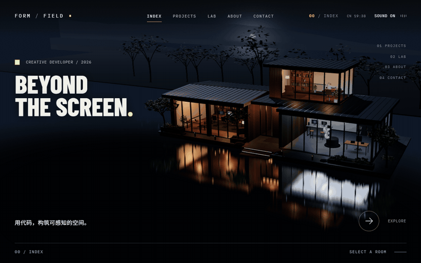
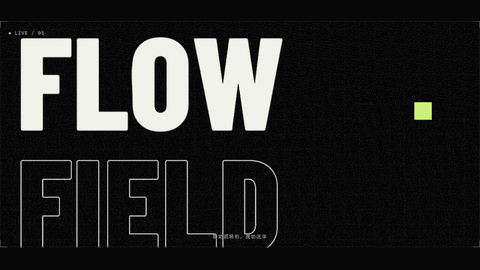
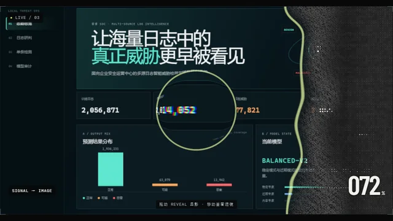
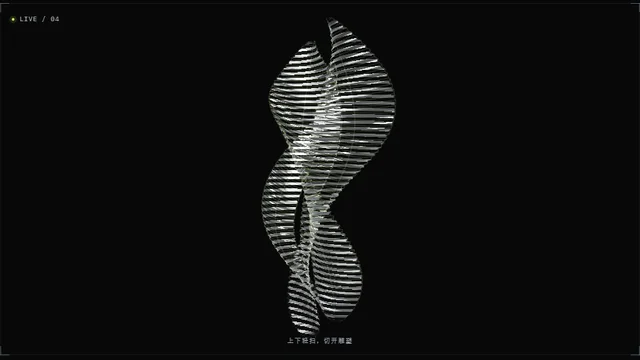
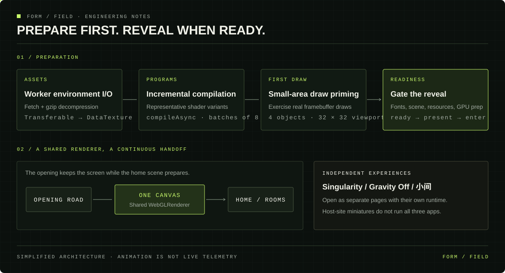
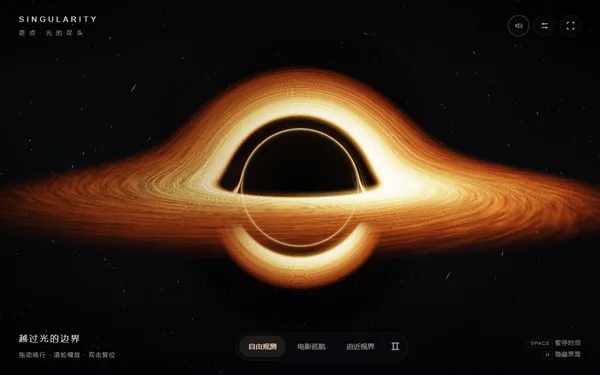
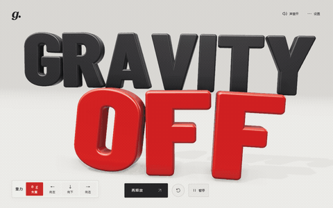
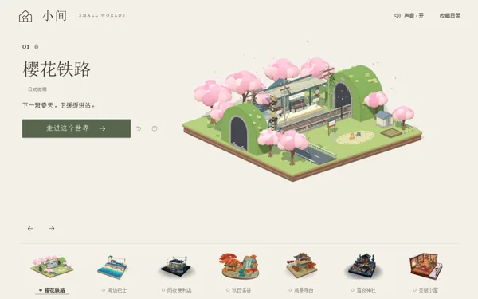

<h1 align="center">AFTERHOURS</h1>

<strong>入夜，让想法成形。</strong> 夜间工坊 · 空间交互、自定义 Shader 与微缩世界。

<a href="https://playertc5418-art.github.io/afterhours/">进入网站 ↗</a> · <a href="docs/ENGINEERING.zh-CN.md">工程笔记</a>

## 让空间成为界面

房间承担导航，物件连接章节。一座夜间建筑通过相机运动和三维到 DOM 的接力，串起项目案例、图形实验与微缩世界。

射线命中代理随场景透视变化。房间检视和物件激活分开管理，在章节接力前协调相机、滚动与焦点。

## 四个图形实验

<table>
<tr>
<td width="50%" align="center">

 <strong>01 / 流体文字</strong>
</td>
<td width="50%" align="center">

 <strong>02 / 粒子形变</strong>
</td>
</tr>
<tr>
<td width="50%" align="center">

 <strong>03 / 媒体显影</strong>
</td>
<td width="50%" align="center">

 <strong>04 / 材质研究</strong>
</td>
</tr>
</table>

- **流体文字**：HalfFloat Ping-Pong 流场结合半拉格朗日自平流、指针力注入与耗散；文字 Shader 采样速度，驱动 UV 推移和 RGB 错位。
- **粒子形变**：文字与雕塑目标预存于缓冲区属性，顶点 Shader 完成延迟插值、排斥和冲击波，动画通过 uniform 驱动。
- **媒体显影**：原图亮度决定半色调点的形态，再逐步显影为原图；指针透镜加入局部折射和色散。
- **材质研究**：实体、结构线和点云从同一基础形体派生，共享扭转与剖切控制，呈现五种视觉状态。

## 为首次交互提前准备

- **开场与首页共用 renderer**：同一 canvas 在两个阶段交接，并明确恢复对应渲染状态。
- **Worker 准备环境数据**：读取、校验与解压放在 Worker，通过可转移缓冲区交回主线程，再构建纹理。
- **小批次完成准备**：代表性的 Shader 变体分帧编译，再进行小区域真实绘制预热；实际任务控制揭示时机，处理暂停、取消与失败回退。

[查看实现细节与设计取舍 →](docs/ENGINEERING.zh-CN.md)

## 三个独立世界

<table>
<tr>
<td width="33%" align="center">

 <a href="https://playertc5418-art.github.io/afterhours/sites/blackhole/">奇点 ↗</a>
</td>
<td width="33%" align="center">

 <a href="https://playertc5418-art.github.io/afterhours/sites/gravity-off/">失重 ↗</a>
</td>
<td width="33%" align="center">

 <a href="https://playertc5418-art.github.io/afterhours/sites/xiaojian/">小间 ↗</a>
</td>
</tr>
</table>

**奇点**将黑洞视觉与距离响应声景结合。**GRAVITY OFF** 使用 Three.js 与 Rapier，让字形可以拖动、释放和重组。**小间**收藏由光线、天气和声音塑造的微缩场景。

主站展示它们的微缩入口；完整作品在独立页面运行，各自管理生命周期。

<code>React</code> · <code>TypeScript</code> · <code>Three.js</code> · <code>GLSL</code> · <code>GSAP</code> · <code>Lenis</code>

<strong>项目案例、范围与署名</strong>

作品集也介绍 **智盾 SOC**、**HEMW**、**CodeEdu–Trace** 的实现与成果范围，相关后端与模型不在 GitHub Pages 中运行。

本仓库发布静态站点。网站实现桌面/触屏布局、减少动态效果与 WebGL 回退；既有检查覆盖 Windows Chromium 与手机尺寸模拟，未覆盖完整真机矩阵。

预览来自真实浏览器，流程图为架构示意。共享 renderer 的范围限定于开场和主站；Rapier 用于独立的 GRAVITY OFF。

背景音乐：Scott Buckley — **Meanwhile**，[作者与许可](https://playertc5418-art.github.io/afterhours/audio/credits.html)。奇点保留 NASA/Chandra 数据声音化素材署名，第三方字体、代码和材质许可随站点保留。

