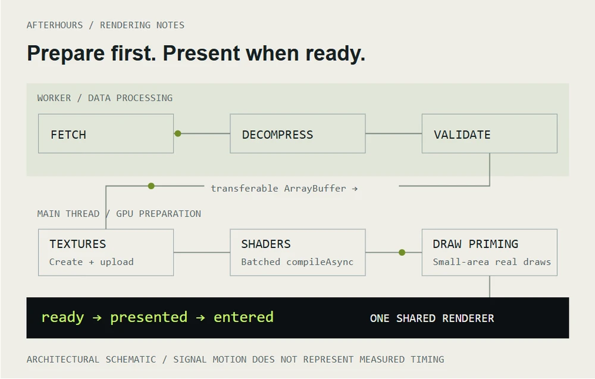

# AFTERHOURS · 工程笔记

第三方库、直接改编组件与素材来源，见[来源与署名](CREDITS.zh-CN.md)。其中开场道路基于 David Haz / React Bits 的 Hyperspeed 改编；本文讲解项目集成，不宣称所有底层技术均为原创。

[English](ENGINEERING.md) · **简体中文**

[返回 README](../README.zh-CN.md) · [在线体验](https://playertc5418-art.github.io/afterhours/)

主站将空间导航、自定义图形实验与页面阅读放进同一段体验。这里展开算法、状态与资源管理方面的实现，以及相应的取舍。

## 空间如何成为界面

建筑中的房间承担导航功能。`Raycaster` 对不可见的三维代理做命中测试，代理随场景变换投影到屏幕。维护它们需要与视觉模型同步，命中区域也因此能够跟随透视变化。

房间聚焦和内部物件激活是两步操作：

```text
overview → entering → inspecting → handoff
  总览       聚焦         检视        章节接力
```

聚焦阶段协调相机、滚动锁定与焦点；检视阶段提供返回按钮和 Escape。环视设置拖拽阈值与角度范围，区分点击和移动。物件接力时，场景的姿态、屏幕投影与章节进度共同决定三维对象和 DOM 内容如何衔接。

这套设计多出一次确认操作和一组状态管理，但给“发现房间、检视物件、进入内容”建立了明确的操作层次。GSAP 与 Lenis 参与时间、滚动和章节编排，Three.js 负责相机、模型与投影。

## 图形实验

### 流体文字：模拟与显示分离

流场使用两个 HalfFloat RenderTarget 交替读写：

```text
上帧速度场 → 反向采样自平流 → 旋转响应 / 指针注入
      ↑                              ↓
    交换读写 ← 耗散与边缘衰减 ← 当前速度场
                                     ↓
                             文字 UV 偏移 / RGB 色散
```

片元 Shader 沿速度反向回溯采样，并根据邻域速度差加入旋转响应。指针移动通过高斯笔刷注入力，流场在耗散和边缘衰减下逐渐平复。

显示阶段读取流场的速度与墨迹分量，驱动文字 UV 偏移、RGB 分通道采样和轻微轨迹着色。流场采用较低的独立分辨率，控制的是模拟更新成本；最终显示仍有对应的屏幕渲染开销。

这是面向交互表现的简化流场，没有完整的散度、压力迭代及投影管线。设备不支持所需浮点渲染目标时，文字材质使用解析式指针涟漪回退。

### 粒子：预存目标，GPU 驱动形变

初始化阶段从 Canvas2D 栅格文字采样 CODE / FORM 点集，从雕塑基础几何获取另一组目标。位置、随机种子与散开方向写入 `BufferGeometry` 属性。

动画阶段由顶点 Shader 完成：

1. 按每个粒子的随机种子设置局部延迟，在源、目标点集之间插值。
2. 在形变途中叠加散开位移，避免点集像整块平移。
3. 在局部空间计算指针排斥。
4. 根据点击位置和时间计算向外传播的环形冲击波。

CPU 更新目标选择、混合进度和指针等 uniform，无须每帧逐粒子重算并上传位置。目标采样和缓冲区构建仍发生在初始化阶段；将动画移入 Shader 不等于整个应用不再有 CPU 工作。移动分支采用较低的粒子数量。

### 媒体显影：亮度、扫描前沿与局部透镜

片元 Shader 以原图亮度控制半色调点的半径，扫描前沿组织噪波、网格、点阵与原图之间的过渡。`uReveal` 驱动显影，`uLens` 控制指针附近的局部放大/折射，RGB 分通道采样形成色散，部分变化与指针速度关联。

这是一组实时图像采样与混合规则，适合交互探索；局部折射属于屏幕空间效果。

### 材质研究：从同一基础形体派生视觉层

基础几何派生出实体、结构线与点云表达。线层复用基础属性并建立自己的索引，点层按采样步长提取属性；各层统一同步时间、指针、滚动和扭转参数。

剖切、透明与层间混合组织出 X-RAY、SOLID、WIRE、SLICED、POINTS 等状态。绘制根据层的不透明度启停，减少不可见层的额外工作。

因此，这里应描述为同一基础形体的多种表达，不能等同于全程只有一个几何对象或一套物理材料仿真。

## 渲染与资源准备

### 一个 renderer，两个阶段

`RenderHost` 创建 `WebGLRenderer`，开场公路与建筑首页共用 canvas。主站准备绘制先执行，开场画面随后覆盖，主站可以在正式出现前完成一部分首次使用工作。

交接时恢复 render target、viewport、scissor、自动清屏、色彩输出、tone mapping、曝光及阴影配置，避免阶段之间残留的图形状态相互影响。进入首页后，canvas 交给主站容器。

共享范围是开场与主站。独立作品在各自页面创建和管理运行时。

### Worker：处理数据，主线程创建纹理

Worker 读取烘焙环境数据，检查文件头、尺寸与字节长度，并按需进行 gzip 解压。结果通过 transferable `ArrayBuffer` 传回主线程，之后构建 HalfFloat `DataTexture`，供环境反射使用。

Worker 不创建 WebGL context，也不负责 GPU 上传。请求、解压或格式校验失败时，资源状态记录回退结果。下载持续等待超过 15 秒时终止 Worker，交给已有的运行时环境生成路径继续准备场景。PBR 材质图片等待超过 15 秒时先使用中性贴图，原请求稍后成功仍可替换回真实图片；外层准备期限为 90 秒。

### Shader 编译与真实绘制分别准备

编译候选按材质、对象类型、实例化属性、顶点与 morph 布局去重，选择代表对象，每批 8 个调用 `compileAsync`，批次之间让出动画帧。

编译后，每批最多 4 个对象在 `32 × 32` 的 viewport/scissor 区域执行真实 framebuffer 绘制，并准备阴影状态。它覆盖的是仅编译未必能完成的首次使用工作，不应被理解为画面最终只以这个分辨率渲染。

批次结束后恢复可见性、裁剪、target 和 scissor。后台或暂停时等待恢复，取消通过 `AbortSignal` 退出；仍在编译的资源等相关任务结束后再释放。

### 从任务进度到画面揭示

模块、字体、场景、表面资源、Shader 与预热分别记录进度；资源集合记录完成与回退情况。正常路径将三个状态分开管理：

```text
ready：准备条件满足
  ↓
presented：允许画面呈现
  ↓
entered：进入主站体验
```

跳过开场、减少动态效果与失败回退具有各自的处理路径。加载动画的视觉进度不能代替这些实际准备结果。

这些策略将部分工作前移并切分。网络、驱动、Shader 缓存和 GPU 仍会影响准备时间与交互表现，不由单次本机采样推导全设备的固定 FPS。

## 独立作品与技术边界

| 作品 | 实现重点 |
| --- | --- |
| 奇点 | 原生 WebGL 与自定义 GLSL，Web Audio 声景，距离对声音强度和音色的联动 |
| GRAVITY OFF | Three.js 渲染与 Rapier 物理，释放、拖动、重力切换、暂停与重组 |
| 小间 | 微缩场景的尺度、材质、灯光、天气与声音编排 |

主站展台只展示微缩入口，不同时挂载三个完整应用，也不在字形缩略模型里运行整套物理。

## 技术栈

| 技术 | 职责 |
| --- | --- |
| React + TypeScript | 内容界面、交互控制、案例弹层与状态组织 |
| Three.js / WebGL / GLSL | 空间渲染、射线命中、自定义流场与 Shader 实验 |
| GSAP + Lenis | 动画时间、滚动与章节协调 |
| Worker + transferable ArrayBuffer | 环境数据读取、解压与转移 |
| Vite | 静态资源构建与模块打包 |
| Web Audio / Rapier | 分别用于声音控制和独立失重作品的物理模拟 |

主站直接使用 Three.js。实现所用版本约束为 React `^19.1.0`、Three.js `^0.180.0`、GSAP `^3.13.0`、Lenis `^1.3.11`、TypeScript `~5.9.2`、Vite `^7.1.0`。

## 发布与验证说明

本仓库提供静态产物，文中的模块和函数名用于解释实现，不构成完整源码工程的公开入口。本文依据对应实现整理，没有新增性能基准结果。

既有发布检查覆盖 Windows Chromium 桌面、手机尺寸模拟、主要入口和案例详情。真实手机、Safari 与低端 GPU 需要独立验收；不同版本的历史记录不能当作当前版本全部重新通过。

[返回 README](../README.zh-CN.md)


## 把效果拆开，逐步理解

下面的缩减代码有意省略应用结构，用于解释已发布的算法，**不是可直接替换的文件或完整可运行源码工程**。先理解一个 pass 或一个交互的输入输出，再补上外围生命周期。

### 1. 先理解双缓冲的边界

一次模拟中读取和写入不同的纹理，避免一边把纹理作为渲染目标，一边又采样它造成反馈问题。缩减流程为：

```js
uniforms.uPrev.value = read.texture;
renderer.setRenderTarget(write);
renderer.render(fieldScene, fieldCamera);
renderer.setRenderTarget(null);
[read, write] = [write, read];
```

场着色器先沿上一帧速度回溯，再叠加指针注入和衰减；显示着色器采样最终流场。学习时可以先把速度显示为颜色，再用它扰动文字 UV；固定指针力度，观察改变耗散率的影响。

### 2. 把粒子目标与动画状态分开

实际着色器用保存的随机种子错开各粒子的变形时间：

```glsl
float local = smoothstep(aSeed * 0.45,
                         aSeed * 0.45 + 0.55, uMix);
vec3 p = mix(shape(uFrom), shape(uTo), local);
p += aScatter * sin(local * 3.14159) * 0.55 * motion;
```

目标点留在顶点属性中，uniform 描述当前过渡，指针排斥和径向冲量继续叠加位置偏移。先关闭散射，可以更清楚地观察目标对应关系与重采样的局限。

### 3. 分别检查显影、透镜与构图

显影先用亮度控制圆点大小，再用扫描遮罩混合阶段；透镜改变指针附近的采样 UV，不修改原图。按宽高比计算的 cover 采样又是独立步骤。

先用纯灰图检查点阵和扫描遮罩，再在固定显影进度下启用透镜。把控制分开，才能分辨问题来自构图还是着色效果。

### 4. 每种表示都应使用一致的变形

材质实验从同一基础形体派生实体、线与点，对可见表示应用对应的扭转和剖切输入，避免实体已经运动而线框还停在原位。

同时检查可见性与透明度：隐藏已经退出的图层，可以避免无意义绘制；仅把透明度降为零，不等于完成了绘制调度。

### 5. 转移环境数据，再在主线程上传

环境 Worker 将解码后的缓冲区转移回来：

```js
self.postMessage({ maps }, {
  transfer: maps.map(map => map.data)
});
```

转移后 Worker 不再持有一份可继续使用的原缓冲区。接收侧仍需创建纹理并上传 GPU。文件头、尺寸、字节数、gzip 检测、取消与超时都属于完整实现，不能被这个小示例掩盖。

### 6. 编译之后，还要让真实绘制走过一次

`compileAsync` 准备着色器程序，第一次真正 draw 仍可能遇到缓冲上传、纹理上传、阴影准备或驱动工作。实现按每批八个代表对象编译，再以最多四个对象一批进行小面积绘制预热。

这属于调度策略，不是性能保证。要检查冷加载、请求失败与返回过渡后的真实进入帧，并在准备后恢复视口、裁剪区、目标、可见性和剔除状态。

### 7. 把物理时间与显示时间分开

失重作品累计经过时间，按固定步长更新仿真，并限制追赶工作。缩减流程为：

```js
accumulator += elapsed;
let steps = 0;
while (accumulator >= 1 / 60 && steps < 4) {
  simulation.step();
  accumulator -= 1 / 60;
  steps++;
}
```

应用外围还有暂停和交互状态。固定步长不等于画面实测 60 fps；重组时切换为运动学控制，避免设计好的归位运动与自由碰撞互相对抗。

### 8. 平滑驱动距离联动声音

奇点将相机距离的倒数映射为平滑接近程度，再据此设置增益和低通频率目标，使用 `setTargetAtTime` 平滑变化，避免每帧把音量当作开关硬切。

动图不能证明声音质量。需要打开页面，经用户操作启用音频，再比较远近位置的声音。录音素材的署名与程序合成的氛围层也应分开说明。

### 9. 为每个世界保留身份和退出路径

小间检查消息来源、发送窗口、协议版本与场景实例，防止上一个场景迟到的就绪或拍照消息改变当前场景。淘汰时先请求释放，等待确认或有限超时后再移除 frame。

可以通过快速切换、返回缓存场景、打开弹层和隐藏标签页复现场景生命周期问题。检查实际是否仍在绘制或播放声音，不能假定隐藏 iframe 就已经停止。

## 阅读已发布的真实实现

以下是当前发行文件，不是完整 TypeScript 开发目录。主站文件明确标为 bundle，可搜索函数名对照上面的说明。

| 主题 | 已发布文件与入口 |
| --- | --- |
| 流场、粒子、材质实验 | [主站图形 bundle](../assets/World-C9Mo80hw.js)：`createFlow`、`particleTextSteps`、`createArtifact` |
| 开场状态与共享渲染器 | [主站入口 bundle](../assets/index-Cu9ZWOIE.js)：`RenderHost`、`Opening` |
| 环境解压 | [Worker 发行文件](../assets/environment.worker-CH5BMuaY.js) |
| 黑洞光线步进与后处理 | [奇点 GLSL](../sites/blackhole/app/shaders.mjs) |
| 距离到声音的映射 | [奇点音频](../sites/blackhole/app/audio.mjs)：`intensity`、`applyMix` |
| 分辨率预算与上下文恢复 | [奇点渲染器](../sites/blackhole/app/renderer.mjs) |
| 刚体与重组 | [失重作品 bundle](../sites/gravity-off/app.js)：仿真和固定步长循环 |

## 继续学习

- [Three.js Raycaster](https://threejs.org/docs/pages/Raycaster.html)：命中射线与交点。
- [Three.js BufferGeometry](https://threejs.org/docs/pages/BufferGeometry.html)：逐顶点数据与属性。
- [Three.js WebGLRenderer](https://threejs.org/docs/pages/WebGLRenderer.html)：绘制、渲染目标和编译 API。
- [MDN：可转移对象](https://developer.mozilla.org/en-US/docs/Web/API/Web_Workers_API/Transferable_objects)：所有权转移与分离后的缓冲区。
- [Rapier 刚体](https://rapier.rs/docs/user_guides/javascript/rigid_bodies/)：动态和运动学刚体。

这些资料解释基础 API；上面的项目行为与边界来自实际实现，不代表获得这些项目背书。

[贡献复现报告或改进](../CONTRIBUTING.zh-CN.md) · [返回 README](../README.zh-CN.md)

## 配图说明

README 中的流场箭头与状态节点属于讲解示意，未读取 GPU 流场或性能日志。图内的浏览器画面来自真实录制，粒子补录覆盖 CODE、FORM、SCULPTURE 和 IMPULSE。材质静态对照选取每次切换后的帧；录屏采样与 GIF 播放速度不能用来证明实际帧率。

[](readme/preparation-v2.svg)

README 默认使用静态 WebP 预览，每个预览链接保留完整 GIF 与在线体验入口，以减少默认下载和动画解码负担。
